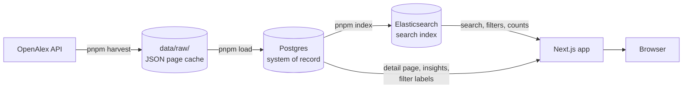

# TheGreenDiamond

Scholarly publications on climate change from Danish research institutions,
published in 2025, harvested from [OpenAlex](https://openalex.org) and made
searchable. A solution to the "OpenAlex Data" programming challenge
(`Challenge.pdf`).

| Where to look            | For                                                     |
| ------------------------ | ------------------------------------------------------- |
| This file                | Architecture, how to run, how to deploy, limitations    |
| `PROMPTS.md`             | How AI tools were used, and how their output was checked |
| `docs/WALKTHROUGH.md`    | A guided tour of the code and the reasoning behind it   |
| `GLOSSARY.md`, `docs/adr/` | The domain language and the recorded decisions        |

## Quick start

With Docker running:

```bash
docker compose up --build
```

Then open <http://localhost:3000>. The first start takes a few minutes: a
one-shot `seed` service creates the tables, harvests 1,000 publications from
OpenAlex, loads them into Postgres and builds the Elasticsearch index, and the
web app starts when it has finished. No API key is needed.

## What it does

- **Search page** (`/`): a search bar over title, abstract, author,
  institution, country and topic; five filters (topic, country, institution,
  author, open access status); a sortable, paginated results table.
- **Detail page** (`/publications/{id}`): abstract, full author list with
  affiliations and their countries, citation count, DOI and other links,
  topics and open access status.
- **Insights page** (`/insights`): the optional Task 4 analyses.

The filters work differently from the usual sidebar of checkboxes. They are
applied **in an order the user controls**, and each one shows how many
publications reach it and how many it leaves, like the rows of a query plan:

```text
All publications            1000
Search "climate"            1000 → 925
Country is any of Germany    925 → 194
Open access is none of gold  194 → 143
Results                      143
```

A filter can be negated ("is none of"), switched off without losing its
values, and dragged to another position. Reordering never changes the result,
only the counts along the way. This design was chosen over five rounds of UI
prototyping (ADR-0003; the prototypes are on the `prototype/search-ui` branch).

## Architecture



| Component | Where | What it does |
| --- | --- | --- |
| Harvester | `scripts/harvest.ts`, `src/server/openalex/client.ts`, `cache.ts` | Fetches the challenge query in 5 pages of 200 and caches the raw JSON in `data/raw/`. Works whose author list was cut at 100 by the list endpoint are fetched again one by one. |
| Loader | `scripts/load.ts`, `src/server/openalex/mapper.ts`, `load.ts` | Maps each raw work to rows and upserts them, one page per transaction. Idempotent. |
| Postgres | `src/server/db/schema.ts` (Drizzle ORM) | Seven normalised tables: publications, authors, institutions, topics, and the links between them (authorships, affiliations, publication_topics). Also keeps each raw work as JSON. |
| Indexer | `scripts/index.ts`, `src/server/search/document.ts`, `build-index.ts` | Reads every publication from Postgres, flattens it to one document, and rebuilds the index from scratch. |
| Search service | `src/server/search/query.ts`, `service.ts` | Turns the search state into one Elasticsearch request that returns the page of results and every per-filter count. |
| Web app | `src/app/`, `src/components/` | Next.js 16 App Router. Pages are Server Components that call the services directly; the same services are exposed as JSON under `/api/publications`. |

Postgres is the system of record and Elasticsearch is a projection of it that
can be dropped and rebuilt at any time (ADR-0001). The search page reads
Elasticsearch; the detail page and the insights read Postgres.

**The URL is the state.** Search text, filters, their order, sort and page all
live in the query string (`/?q=ice&countries=DE&oa=gold&order=countries,oa&not=oa`),
so any view can be reloaded, bookmarked or shared.

### API

| Endpoint | Returns |
| --- | --- |
| `GET /api/publications?q=&topics=&countries=&institutions=&authors=&oa=&order=&not=&off=&sort=&page=&size=` | One page of results, the total, and the counts for the search and each filter |
| `GET /api/publications/options?key=topics&…` | Every value of one filter with two counts: publications reaching that filter, and overall |
| `GET /api/publications/{id}` | One publication in full, or 404 |

## Running it for development

Prerequisites: Docker, Node 24 (`nvm use`), and pnpm through corepack
(`corepack enable`).

```bash
cp .env.example .env              # OPENALEX_API_KEY is optional
docker compose up -d postgres elasticsearch
pnpm install
pnpm db:push                      # create the tables from the Drizzle schema
pnpm harvest                      # cache 1,000 works from OpenAlex in data/raw/
pnpm load                         # load the cache into Postgres
pnpm index                        # build the Elasticsearch index from Postgres
pnpm dev                          # http://localhost:3000
```

Every data step can be run again safely. `pnpm harvest` skips files it has
already cached (pass `--force` to fetch again); `pnpm load` upserts;
`pnpm index` replaces the index.

### Configuration

| Variable              | Purpose                                                   |
| --------------------- | --------------------------------------------------------- |
| `DATABASE_URL`        | Postgres connection string                                |
| `ELASTICSEARCH_URL`   | Elasticsearch base URL                                    |
| `ELASTICSEARCH_INDEX` | Index name, `publications` by default                     |
| `OPENALEX_API_KEY`    | Optional. With a key the harvester pages by cursor; without one, by page number |

### Tests

```bash
pnpm test               # unit tests: mapper, search state, document builder, query builder
pnpm test:integration   # against the Compose services: load, index, search, insights
pnpm lint
pnpm tsc --noEmit
```

Integration tests use their own database (`thegreendiamond_test`) and index
(`publications_test`) on the same servers, so they never touch development
data. They load five real OpenAlex works kept as a fixture.

## Deployment

The app is not deployed publicly. The intended deployment is the same Compose
stack on a single virtual machine:

1. Install Docker on the machine and clone the repository.
2. Run `docker compose up --build -d`. The `seed` service fills Postgres and
   Elasticsearch, then `web` starts on port 3000.

Manual steps that the code does not automate:

- **Secrets:** change the Postgres password in `docker-compose.yml` (it is a
  local development default), and set `OPENALEX_API_KEY` in the environment if
  you have one.
- **Elasticsearch security** is switched off (`xpack.security.enabled: false`)
  and both data stores publish their ports to the host. For a real deployment,
  remove the `ports` entries of `postgres` and `elasticsearch`, or enable
  security.
- **TLS and a domain:** put a reverse proxy such as Caddy or nginx in front of
  port 3000.
- **Backups:** only the `postgres-data` volume needs backing up. The index can
  always be rebuilt with `pnpm index`, and the harvest cache with `pnpm harvest`.
- **Refreshing the data:** run the seed again with
  `docker compose run --rm seed sh -c "pnpm harvest --force && pnpm load && pnpm run index"`.

A managed alternative would be the Next.js app on a Node host with managed
Postgres and Elasticsearch; only the two connection URLs change.

## Assumptions and limitations

- **1,000 of about 5,000.** The challenge query matches about 5,000 works. We
  keep the first 1,000 in OpenAlex's relevance order, as the brief allows.
  Counts and insights describe that sample, not Danish climate research as a whole.
- **Topics, not concepts.** The brief says "Concepts (topics)". OpenAlex has
  both; concepts are deprecated, so the app uses topics (ADR-0002).
- **Authors are OpenAlex's.** An author is whoever OpenAlex's disambiguation
  says it is. 631 author-list entries were not resolved to an author at all.
  They are kept and shown by their printed name, and their affiliations count
  for the institution and country filters, but they cannot be picked in the
  author filter or counted in the insights (ADR-0004).
- **A country belongs to an institution.** A publication has a country if any
  affiliated institution is there. Some institutions have no known country.
- **Search is simple.** Every word must match somewhere (title counts most).
  There is no phrase search, typo tolerance or highlighting.
- **The author picker is long.** It lists about 7,600 authors, shows the first
  200, and relies on its name box for the rest (ADR-0005).
- **Malformed URL parameters are ignored**, not rejected (ADR-0006).
- **An unknown publication ID** shows the "not found" page, but the page's
  HTTP status is 200, because the page streams and the status line has
  already been sent. The JSON API returns a proper 404.
- **No automated UI tests.** The UI was checked with a scripted browser pass
  (search, every filter action, keyboard reordering, sorting, pagination,
  phone width, console errors) that is not part of the repository.
- **Light theme only.**

## Ideas

- Incremental harvest using OpenAlex's `updated_date`, and harvesting all
  matching works instead of 1,000.
- Zero-downtime reindexing through an index alias, instead of delete and rebuild.
- Typo tolerance and highlighted matches in the results.
- Virtual scrolling in the value picker, so that every author can be listed.
- End-to-end tests in the repository (Playwright), run in CI.
- More insights: publications per month, open access share per institution,
  co-authorship between countries.
